# STM32 SBUS USB HID Joystick — Türkçe Kurulum Rehberi


Bu proje, **Radiolink AT9S Pro** kumandayı ve **Radiolink R9DS v2.1** alıcısını, bir **NUCLEO-F303RE** kartı üzerinden bilgisayara gerçek bir **USB HID Joystick** olarak bağlar.

Bu README özellikle **STM32, elektronik veya USB HID hakkında hiçbir şey bilmeyen bir kişinin** projeyi baştan sona uygulayabilmesi için yazılmıştır. Hazır firmware'i karta yükleyip bağlantıları doğru yaptığınızda Windows cihazı şu isimle görür:

```text
STM32 SBUS Joystick
Status: OK
```

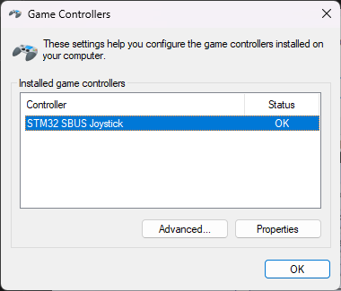

> **En önemli nokta:** NUCLEO üzerindeki ST-LINK USB girişi joystick bağlantısı değildir. ST-LINK; programlama, debug, seri port ve geliştirme sırasında güç için kullanılır. Joystick verisi STM32'nin **PA11 (D-)** ve **PA12 (D+)** pinlerinden ayrı bir USB veri kablosuyla bilgisayara gider.

---

## İçindekiler

1. [Proje sonunda ne elde edeceksiniz?](#1-proje-sonunda-ne-elde-edeceksiniz)
2. [Hiç bilmeyenler için 1 dakikalık açıklama](#2-hiç-bilmeyenler-için-1-dakikalık-açıklama)
3. [Gerekli parçalar](#3-gerekli-parçalar)
4. [İki farklı USB bağlantısını anlamak](#4-iki-farklı-usb-bağlantısını-anlamak)
5. [En kolay yöntem: hazır firmware'i karta yüklemek](#5-en-kolay-yöntem-hazır-firmwarei-karta-yüklemek)
6. [R9DS alıcısını STM32'ye bağlamak](#6-r9ds-alıcısını-stm32ye-bağlamak)
7. [SBUS çalışıyor mu? Kontrol etmek](#7-sbus-çalışıyor-mu-kontrol-etmek)
8. [Joystick USB kablosunu hazırlamak](#8-joystick-usb-kablosunu-hazırlamak)
9. [1.5 kΩ pull-up direncini bağlamak](#9-15-kohm-pull-up-direncini-baglamak)
10. [Bilgisayara joystick olarak bağlamak](#10-bilgisayara-joystick-olarak-bağlamak)
11. [Windows joy.cpl ile test](#11-windows-joycpl-ile-test)
12. [PicaSim ayarları](#12-picasim-ayarları)
13. [Kanal eşlemesi](#13-kanal-eşlemesi)
14. [Sorun giderme](#14-sorun-giderme)
15. [Geliştirici yöntemi: STM32CubeIDE ile derleme](#15-geliştirici-yöntemi-stm32cubeide-ile-derleme)
16. [Teknik özet](#16-teknik-özet)
17. [Son kontrol listesi](#17-son-kontrol-listesi)
18. [Ek belgeler](#18-ek-belgeler)

---

# 1. Proje sonunda ne elde edeceksiniz?

Radiolink kumandanızdaki dört ana uçuş kontrolü ve yardımcı kontroller Windows tarafından joystick girdileri olarak okunur:

| Radiolink kanalı | Fiziksel kontrol | Windows HID karşılığı |
|---|---|---|
| CH1 | Sağ stick yatay — Roll | X |
| CH2 | Sağ stick dikey — Pitch | Y |
| CH3 | Sol stick dikey — Throttle | Z |
| CH4 | Sol stick yatay — Yaw | Rz |
| CH5 | C üç konumlu switch | Button 1 / 2 / 3 |
| CH6 | Sol üst rotary knob | Rx |
| CH7 | Sol arka oransal lever | Ry |
| CH8 | Sağ üst rotary knob | Slider |

Windows'ta cihaz `STM32 SBUS Joystick` olarak görünür. Daha sonra PicaSim'de Roll, Pitch, Throttle ve Yaw eşlemesi yapılır.

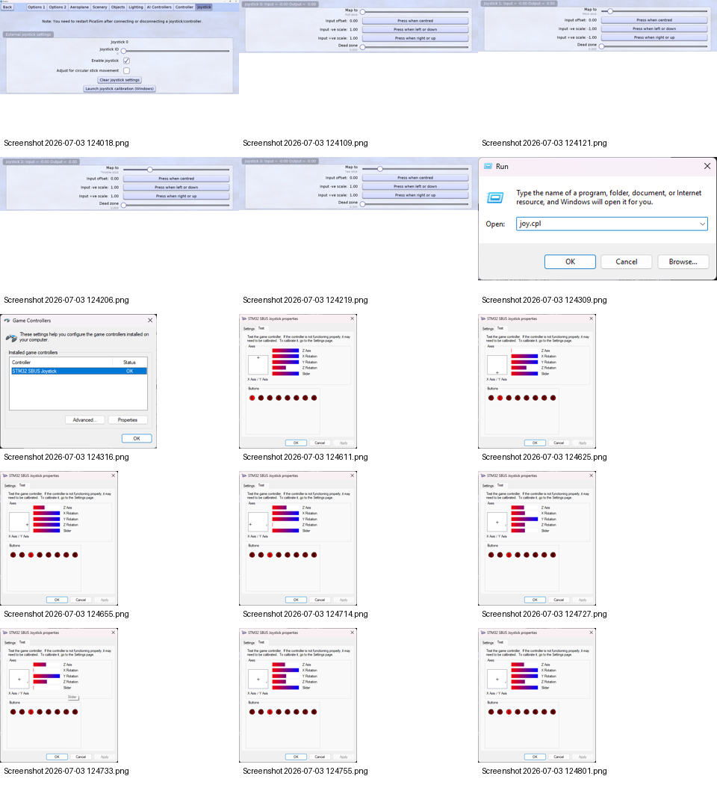

---

# 2. Hiç bilmeyenler için 1 dakikalık açıklama

Sistem şu sırayla çalışır:

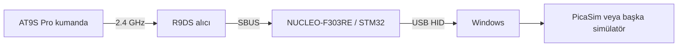

- **AT9S Pro:** Elinizde tuttuğunuz kumanda.
- **R9DS:** Kumandadan gelen radyo sinyalini alır.
- **SBUS:** R9DS'nin birçok kanalı tek bir dijital hat üzerinden STM32'ye gönderdiği veri formatı.
- **STM32 / NUCLEO:** SBUS verisini okur ve bilgisayarın anlayacağı USB joystick verisine çevirir.
- **USB HID:** Windows'un ekstra sürücü kurmadan joystick/game controller olarak tanıdığı standart USB sınıfı.

Firmware tarafında veri akışı şöyledir:

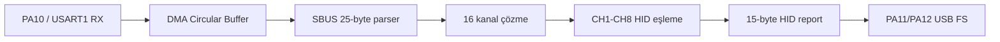

Bu projeyi **kullanmak** için bu detayları bilmeniz gerekmez. Aşağıdaki adımları sırayla uygulamanız yeterlidir.

---

# 3. Gerekli parçalar

## Zorunlu parçalar

| Parça | Adet | Ne işe yarıyor? |
|---|---:|---|
| Radiolink AT9S Pro | 1 | Kumanda |
| Radiolink R9DS v2.1 | 1 | SBUS alıcı |
| NUCLEO-F303RE | 1 | SBUS → USB dönüştürücü |
| ST-LINK için USB kablosu | 1 | Firmware yükleme + kartı besleme |
| USB **data** kablosu | 1 | Joystick D+/D-/GND bağlantısı |
| Jumper kablolar | birkaç | Donanım bağlantıları |
| 1.5 kΩ direnç | 1 | USB D+ pull-up |
| Windows bilgisayar | 1 | Programlama ve joystick kullanımı |

## 1.5 kΩ yoksa

Bu projede başarıyla kullanılan alternatif:

```text
1 kΩ + 330 Ω + 220 Ω = 1550 Ω ≈ 1.55 kΩ
```

Üç direnç **seri** bağlanır. Sıralarının önemi yoktur.

| Değer | 4 bant renk kodu |
|---|---|
| 1 kΩ | Kahverengi – Siyah – Kırmızı – Altın |
| 330 Ω | Turuncu – Turuncu – Kahverengi – Altın |
| 220 Ω | Kırmızı – Kırmızı – Kahverengi – Altın |
| 1.5 kΩ | Kahverengi – Yeşil – Kırmızı – Altın |

## Faydalı ama zorunlu olmayan

- Multimetre
- Micro-USB/USB breakout kartı (kesilmiş kablo yerine daha düzenli bağlantı için)
- Tera Term (SBUS'u görmek için)

> **USB-TTL dönüştürücü (CH340, CP2102, PL2303, FTDI) satın almayın.** Bunlar COM port üretir; joystick için gereken native USB D+ / D- hatlarını sağlamaz.

---

# 4. İki farklı USB bağlantısını anlamak

Geliştirme sırasında iki USB bağlantısı vardır ve görevleri tamamen farklıdır.

## USB 1 — NUCLEO üzerindeki ST-LINK USB

Bunu şu işler için kullanıyoruz:

- Firmware'i STM32'ye yüklemek
- Debug
- Tera Term için Virtual COM Port
- NUCLEO kartını geliştirme sırasında beslemek

**Bu port joystick değildir.**

## USB 2 — STM32 native USB

Bu kablonun yalnızca şu hatlarını kullanıyoruz:

```text
USB D+  → PA12
USB D-  → PA11
USB GND → GND
USB 5V  → ilk testte BAĞLAMA
```

Bu bağlantı sayesinde Windows, STM32'nin kendisini joystick olarak görür.

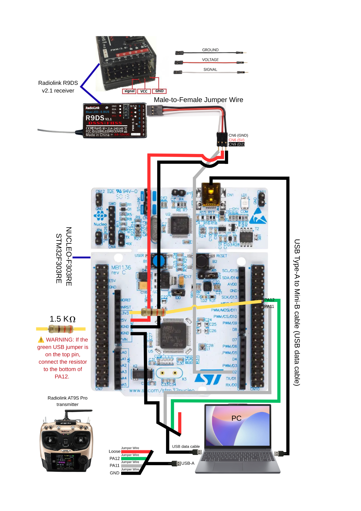

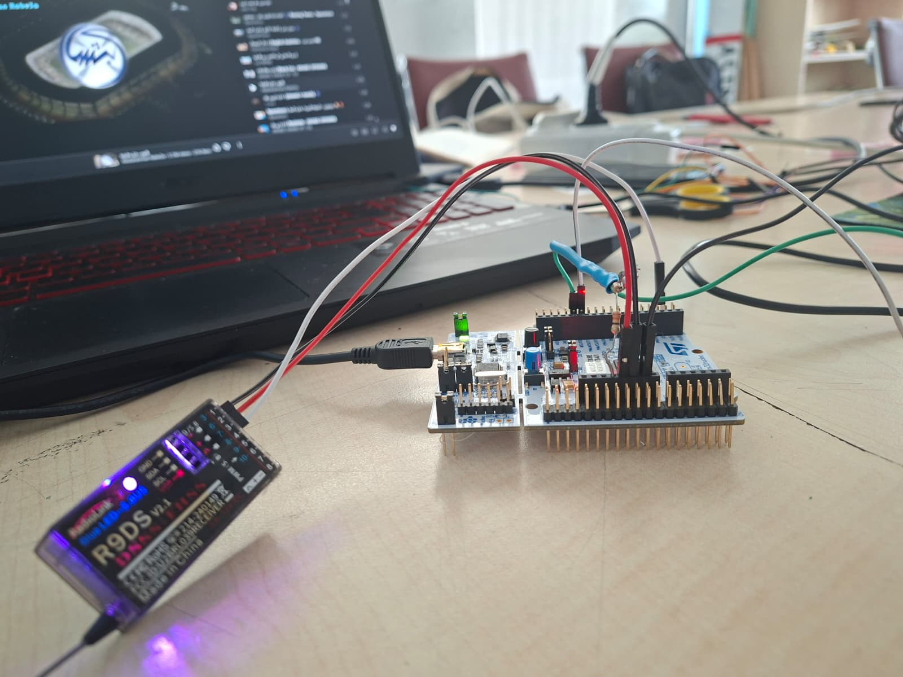

---

# 5. En kolay yöntem: hazır firmware'i karta yüklemek

STM32 kodunu anlamanız veya derlemeniz gerekmez. Repodaki hazır `.elf` dosyasını **STM32CubeProgrammer** ile karta yazabilirsiniz.

## 5.1 STM32CubeProgrammer'ı kurun

STMicroelectronics'in resmi yazılımını kurun:

- https://www.st.com/en/development-tools/stm32cubeprog.html

## 5.2 Kartı bağlayın

1. NUCLEO-F303RE'yi ST-LINK USB portundan bilgisayara bağlayın.
2. Joystick için kesilmiş USB kablosunu **henüz bağlamayın**.
3. R9DS bağlantılarını da isterseniz bu aşamada henüz yapmayabilirsiniz.

## 5.3 Hazır firmware dosyasını açın

Repoda:

```text
release/STM32_SBUS_USB_HID_Joystick.elf
```

STM32CubeProgrammer içinde:

1. Sağ üstte `ST-LINK` bağlantısını seçin.
2. `Connect` düğmesine basın.
3. `.elf` dosyasını açın.
4. `Download` / programlama işlemini başlatın.
5. İşlem başarıyla bittikten sonra kartı yeniden başlatın veya `Reset` düğmesine basın.

### Kontrol noktası 1

Bu aşamada kart programlanmış olmalıdır. Joystick'in Windows'ta görünmemesi **normaldir**, çünkü PA11/PA12 USB kablosunu henüz bağlamadık.

> Kaynak projeyi değiştirmek istemiyorsanız `.ioc` dosyasını açıp **Generate Code** yapmayın. Hazır firmware ve hazır STM32CubeIDE projesi zaten çalışır durumdadır.

---

# 6. R9DS alıcısını STM32'ye bağlamak

## 6.1 Önce güçleri kapatın

Kabloları takarken NUCLEO'yu ve joystick USB kablosunu bilgisayardan çıkarın.

## 6.2 R9DS'yi SBUS moduna alın

Bu projede R9DS **SBUS modunda** çalışır. Doğru durumda alıcının mor LED'i sabit yanıyordu.

> SBUS moduna geçiş yöntemi alıcının firmware/kılavuz sürümüne göre değişebileceğinden burada tuş kombinasyonu uydurulmuyor. Kendi R9DS kılavuzunuzdaki SBUS mode talimatını uygulayın. Hedef: **9/S.B portundan SBUS çıkışı** ve sabit mor LED.

## 6.3 Üç kabloyu bağlayın

| R9DS | NUCLEO-F303RE | Açıklama |
|---|---|---|
| `9/S.B` Signal | **PA10 / D2 / USART1_RX** | SBUS veri hattı |
| VCC | **5V** | Alıcı beslemesi |
| GND | **GND** | Ortak toprak |

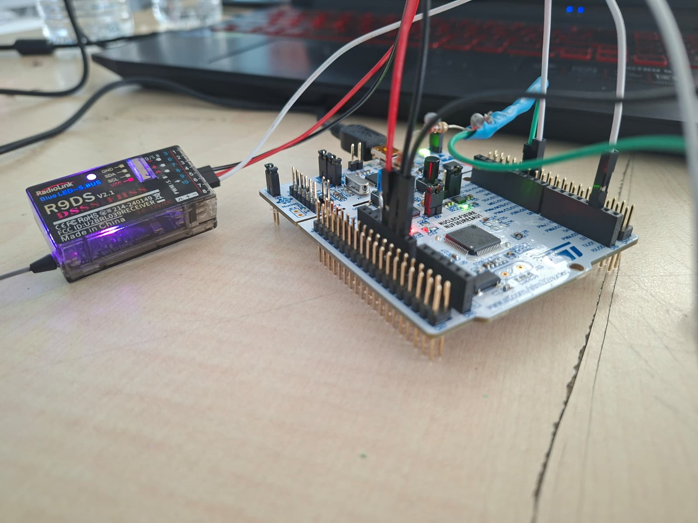

### Çok önemli

- Signal kablosu **PA10**'a gider.
- `PA10`, bu projede `USART1_RX`'tir.
- R9DS ve NUCLEO **ortak GND** kullanmalıdır.

### Kontrol noktası 2

1. ST-LINK USB'yi bilgisayara bağlayın.
2. AT9S Pro'yu açın.
3. R9DS mor LED'i sabit yanmalı.
4. NUCLEO güç LED'leri yanmalı.

---

# 7. SBUS çalışıyor mu? Kontrol etmek

Bu adım zorunlu değil ama **şiddetle önerilir**. USB joystick bağlantısına geçmeden önce alıcıdan veri geldiğini doğrular.

## 7.1 Tera Term kurun

Resmi proje sayfası:

- https://teratermproject.github.io/index-en

## 7.2 COM portu açın

NUCLEO ST-LINK USB takılıyken Windows'ta bir ST-LINK Virtual COM Port oluşur.

Tera Term ayarları:

```text
Baud rate: 115200
Data: 8 bit
Parity: None
Stop: 1 bit
Flow control: None
```

Doğru çalışan sistemde yaklaşık şöyle satırlar görmelisiniz:

```text
fps=74 err=0 | CH1=1000 CH2=1014 CH3= 950 CH4= 995 CH5=1800 CH6=1800 CH7= 252 CH8=1800 | flags=0x00 end=0x00
```

Kumanda sticklerini oynattığınızda ilgili `CH1...CH8` değerleri değişmelidir.

### Normal değerler

```text
fps   ≈ 74–75
err   = 0
flags = 0x00
end   = 0x00
```

### Failsafe testi

Kumandayı kapattığımız doğrulanmış testte:

```text
önce flags = 0x04
sonra flags = 0x0C
CH3 ≈ 200
```

Kumanda tekrar açıldığında `flags=0x00` ve kanallar geri dönmüştür.

### Kontrol noktası 3

Tera Term'de `NO SBUS frames` yerine 74–75 fps civarında gerçek kanal değerleri görüyorsanız alıcı tarafı çalışıyor.

---

# 8. Joystick USB kablosunu hazırlamak

## 8.1 Data kablosu kullandığınızdan emin olun

Bazı USB kabloları yalnızca şarj içindir ve içinde D+ / D- yoktur. Bu proje için **data kablosu** gerekir.

Kesilmiş tipik USB kablosunda renkler çoğunlukla şöyledir:

| Yaygın renk | Sinyal | STM32 bağlantısı |
|---|---|---|
| Yeşil | D+ | PA12 |
| Beyaz | D- | PA11 |
| Siyah | GND | GND |
| Kırmızı | +5V / VBUS | **İlk testte bağlanmaz** |

> Renkler standartta yaygın olsa da her kabloda garanti değildir. Mümkünse multimetre ile kontrol edin veya pin isimleri yazılı bir USB breakout kullanın.

## 8.2 USB hatlarını NUCLEO'ya bağlayın

```text
USB D+  → PA12 / USB_DP
USB D-  → PA11 / USB_DM
USB GND → NUCLEO GND
USB +5V → boşta, izole edilmiş
```

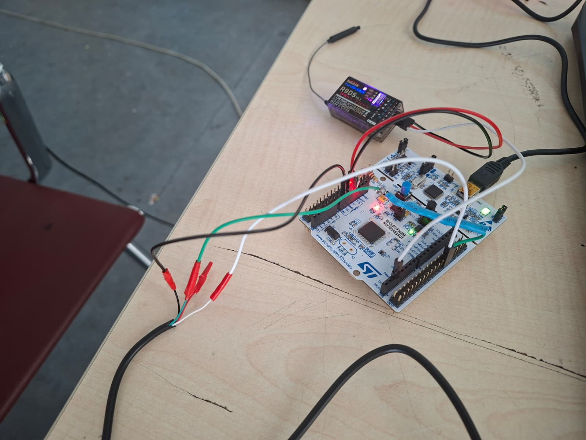

> **Kırmızı USB 5V telini NUCLEO 5V veya 3V3'e bağlamayın.** Geliştirme düzeninde kart zaten ST-LINK USB'den besleniyor.

---

# 9. 1.5 kOhm pull-up direncini baglamak

USB Full-Speed bağlantısı için bu çalışan prototipte D+ hattına yaklaşık 1.5 kΩ pull-up kullanılmıştır.

Bağlantı:

```text
NUCLEO 3V3 ── 1.5 kΩ ── PA12 / D+
```

Elinizde 1.5 kΩ yoksa çalışan alternatif:

```text
3V3 ── 1 kΩ ── 330 Ω ── 220 Ω ── PA12 / D+
```

## 9.1 Multimetre ile kontrol — güç kapalıyken

USB ve ST-LINK kablolarını bilgisayardan çıkarın.

Kontroller:

| Ölçüm | Beklenen |
|---|---|
| 3V3 ↔ GND continuity | **Ötmemeli** |
| 5V ↔ GND continuity | **Ötmemeli** |
| PA12/D+ ↔ PA11/D- continuity | **Ötmemeli** |
| 3V3 ↔ PA12/D+ direnç | yaklaşık **1.5–1.55 kΩ** |

### Kontrol noktası 4

Kısa devre yoksa ve 3V3–PA12 arasında yaklaşık 1.5 kΩ okuyorsanız native USB bağlantısını denemeye hazırsınız.

---

# 10. Bilgisayara joystick olarak bağlamak

Sıra önemlidir:

1. AT9S Pro açık.
2. R9DS çalışıyor ve SBUS çıkışı aktif.
3. ST-LINK USB NUCLEO'ya bağlı; kart programlı ve besleniyor.
4. D+ / D- / GND ve pull-up bağlantısını bir kez daha kontrol edin.
5. Kesilmiş/native USB data kablosunun USB fişini bilgisayara takın.

Windows yeni bir USB HID cihazı algılamalıdır.

> Windows cihazı hiç algılamıyorsa kabloyu çıkarın ve doğrudan [Sorun giderme](#14-sorun-giderme) bölümüne geçin. D+ ve D- hatlarını rastgele değiştirerek deneme yapmayın; önce bağlantıyı doğrulayın.

---

# 11. Windows joy.cpl ile test

## 11.1 Game Controllers penceresini açın

Klavyede:

```text
Win + R
```

şunu yazın:

```text
joy.cpl
```

`Enter` basın.

Beklenen cihaz:

```text
STM32 SBUS Joystick
Status: OK
```


## 11.2 Eksenleri test edin

1. `STM32 SBUS Joystick` seçin.
2. `Properties` açın.
3. `Test` sekmesine geçin.
4. Kumanda sticklerini ve knob'ları hareket ettirin.

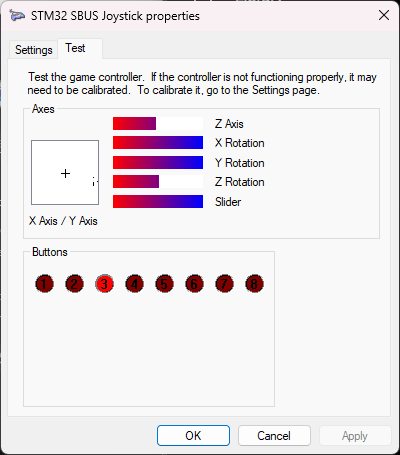

CH5 C switch üç konum arasında hareket ettiğinde Button 1, 2 veya 3 aktif olmalıdır.

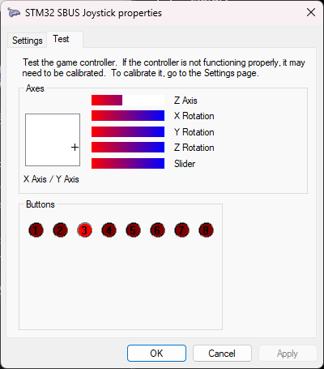

### Kontrol noktası 5

Burada eksenler hareket ediyorsa **STM32 firmware + SBUS + USB HID zinciri çalışıyor** demektir. Bundan sonraki sorunlar çoğunlukla simülatör ayarıdır.

---

# 12. PicaSim ayarları

PicaSim kaynak/proje sayfası:

- https://github.com/Rowlhouse/PicaSim

> PicaSim, joystick bağlandıktan veya çıkarıldıktan sonra yeniden başlatılmalıdır.

## 12.1 Doğru açılış sırası

1. STM32 joystick bağlantısını tamamlayın.
2. `joy.cpl` içinde cihazın çalıştığını doğrulayın.
3. PicaSim açıksa tamamen kapatın.
4. PicaSim'i tekrar açın.
5. `Settings / Joystick` bölümüne girin.

## 12.2 Joystick'i etkinleştirin

- `Joystick ID = 0`
- `Enable joystick = ON`

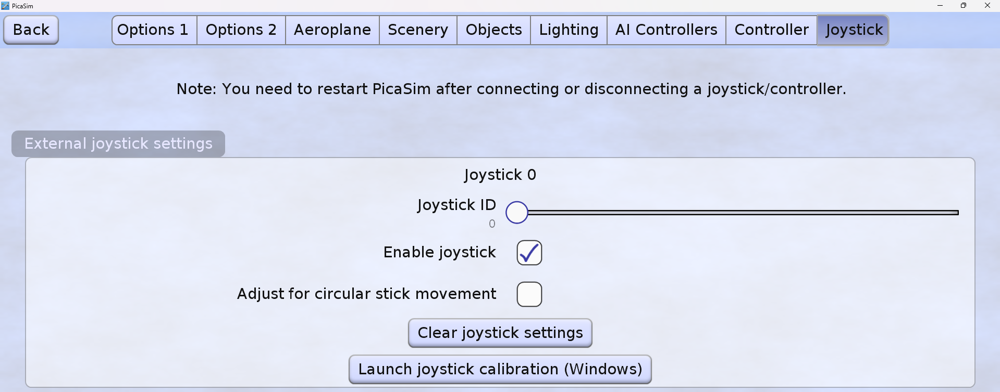

## 12.3 Dört ana uçuş eksenini eşleyin

| PicaSim girişi | Map to |
|---|---|
| Joystick 0 | Roll stick |
| Joystick 1 | Pitch stick |
| Joystick 2 | Throttle stick |
| Joystick 3 | Yaw stick |

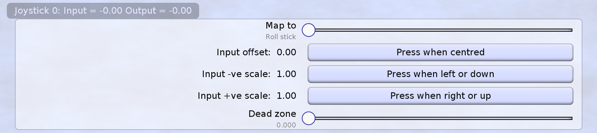

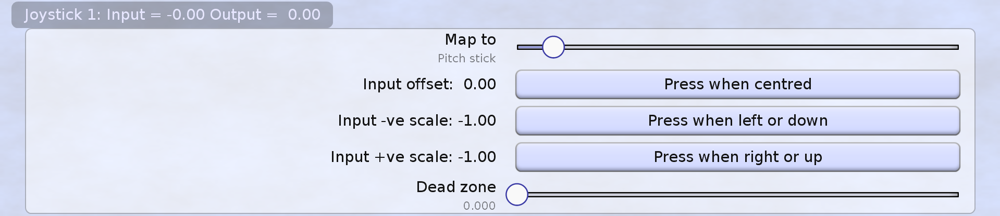

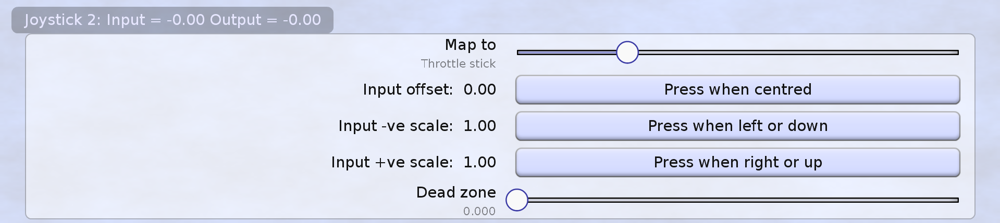

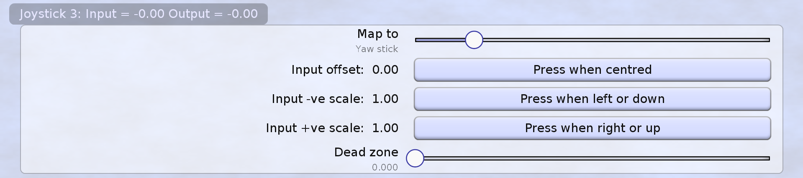

## 12.4 Kalibrasyon

### Roll / Pitch / Yaw

Her eksen için:

1. Stick'i ortaya getirin → `Press when centred`.
2. Stick'i sol/aşağı sonuna götürün → `Press when left or down`.
3. Stick'i sağ/yukarı sonuna götürün → `Press when right or up`.

### Throttle

Throttle spring-center olmadığı için esas olarak minimum ve maksimum noktalarını ayarlayın.

Bir eksen ters çalışıyorsa PicaSim'deki `Invert` seçeneğini kullanın. Firmware'i değiştirmek gerekmez.

### Kontrol noktası 6

PicaSim'de `Map to = None` kalmamalı. Roll, Pitch, Throttle ve Yaw atanmış olmalıdır.

---

# 13. Kanal eşlemesi

Projede ölçülen yaklaşık SBUS değerleri:

| Kanal | Minimum | Merkez | Maksimum |
|---|---:|---:|---:|
| CH1 Roll | ~200 | ~1000 | ~1800 |
| CH2 Pitch | ~200 | ~1013 | ~1800 |
| CH3 Throttle | ~200 | merkez yok | ~1800 |
| CH4 Yaw | ~200 | ~995 | ~1800 |
| CH5 Switch C | ~200 | ~1000 | ~1800 |
| CH6 Knob | ~200 | ~1000 | ~1800 |
| CH7 Lever | ~250 | ~1019 | ~1800 |
| CH8 Knob | ~200 | ~1022 | ~1800 |

Firmware bu aralığı USB HID için `0…32767` aralığına dönüştürür. CH1, CH2 ve CH4 için merkez çevresinde ±25 SBUS birimlik dead-zone uygulanır.

---

# 14. Sorun giderme

## A. `joy.cpl` içinde cihaz hiç görünmüyor

Sırayla kontrol edin:

1. ST-LINK USB ile kart gerçekten çalışıyor mu?
2. Firmware karta yüklendi mi?
3. Native USB kablosu gerçekten **data** kablosu mu?
4. D+ → PA12 doğru mu?
5. D- → PA11 doğru mu?
6. USB GND → GND bağlı mı?
7. 3V3 → ~1.5 kΩ → PA12 pull-up var mı?
8. Kırmızı 5V tel ilk testte boşta mı?
9. USB hatlarında kısa devre var mı?

## B. Tera Term `NO SBUS frames errors=0` yazıyor

Bu, parser'a SBUS frame gelmediğini gösterir.

Kontrol edin:

- R9DS gerçekten SBUS modunda mı?
- 9/S.B signal → PA10 mu?
- R9DS GND → NUCLEO GND bağlı mı?
- R9DS besleme alıyor mu?
- Kumanda açık ve alıcı bağlı mı?

Firmware değiştirdiyseniz ayrıca USART1 ve DMA ayarlarını kontrol edin.

## C. Windows joystick'i görüyor ama PicaSim çalışmıyor

Bu proje sırasında yaşanan gerçek sorun buydu. Çözüm:

- PicaSim'i joystick takılıyken yeniden başlatın.
- `Enable joystick` seçeneğini açın.
- `Map to = None` bırakmayın.
- Joystick 0→Roll, 1→Pitch, 2→Throttle, 3→Yaw eşleyin.

## D. Sadece COM port görüyorum

Muhtemelen USB-TTL dönüştürücü kullanıyorsunuz. Bu yanlış bağlantıdır. Joystick için STM32'nin native USB pinleri **PA11/PA12** kullanılmalıdır.

## E. ST-LINK USB'yi takınca joystick çıkmıyor

Normaldir. ST-LINK USB joystick değildir. Native USB kablosu PA11/PA12/GND'ye ayrıca bağlanmalıdır.

## F. Eksen ters hareket ediyor

PicaSim'de `Invert` seçeneğini kullanın.

## G. Build sırasında `excess elements in array initializer` uyarıları

Custom HID Report Descriptor 50 byte'tır. Çalışan projede:

```c
USBD_CUSTOM_HID_REPORT_DESC_SIZE = 50U
CUSTOM_HID_EPIN_SIZE = 0x10U
HID_JOYSTICK_REPORT_SIZE = 15U
```

Hazır repo projesini değiştirmeden kullanıyorsanız bu değerleri elle düzeltmeniz gerekmez.

Daha geniş tablo: [docs/06-sorun-giderme.md](docs/06-sorun-giderme.md)

---

# 15. Geliştirici yöntemi: STM32CubeIDE ile derleme

Hazır `.elf` yöntemi en kolay yoldur. Kaynak kodu incelemek veya değiştirmek isteyenler için:

## 15.1 STM32CubeIDE kurun

Resmi sayfa:

- https://www.st.com/en/development-tools/stm32cubeide.html

## 15.2 Projeyi import edin

STM32CubeIDE:

```text
File → Import → Existing Projects into Workspace
```

Proje klasörü:

```text
firmware/STM32_Project/F303RE_Blink_Test_v2
```

> Klasör adının `Blink_Test_v2` olması tarihsel bir isimdir. İçerik artık tam SBUS USB HID Joystick firmware'idir.

## 15.3 Build

```text
Project → Build Project
```

veya:

```text
Ctrl + B
```

Doğrulanmış sonuç:

```text
Build Finished. 0 errors, 0 warnings.
```

## 15.4 Flash

NUCLEO ST-LINK USB bağlıyken `Run` veya `Debug` kullanın.

## 15.5 CubeMX hakkında önemli uyarı

Bu projeyi yalnızca kullanmak için CubeMX ayarlarını yeniden yapmanız gerekmez. Özellikle `.ioc` dosyasını açıp `Generate Code` yapmak, elle özelleştirilmiş USB HID dosyalarını değiştirebilir. Ayarları öğrenmek veya projeyi sıfırdan yeniden kurmak istiyorsanız ayrıntılı teknik belgeyi kullanın:

- [docs/07-teknik-detaylar.md](docs/07-teknik-detaylar.md)

---

# 16. Teknik özet

Çalışan firmware'in temel özellikleri:

```text
MCU: STM32F303RE
Board: NUCLEO-F303RE
SBUS input: PA10 / USART1_RX
SBUS UART: 100000 baud, effective 8E2, RX inversion
DMA: DMA1 Channel 5, Circular
DMA buffer: 64 bytes
SBUS frame: 25 bytes
USB: Full-Speed Device
USB pins: PA11 D-, PA12 D+
USB clock: 48 MHz
HID class: Custom HID / Joystick
HID axes: 7 x 16-bit
Buttons declared: 8
Buttons used: 3 (CH5)
HID report: 15 bytes
Descriptor: 50 bytes
HID send interval: about 10 ms when recent SBUS data exists
```

Çalışan SBUS frame doğrulaması:

```text
Start byte = 0x0F
Flags      = frame[23]
End byte   = 0x00
```

Detaylı firmware mimarisi, DMA mantığı, SBUS 11-bit çözme, HID descriptor ve failsafe açıklaması için:

- [docs/07-teknik-detaylar.md](docs/07-teknik-detaylar.md)

---

# 17. Son kontrol listesi

Projeyi tamamladığınızda aşağıdakilerin tamamı doğru olmalı:

- [ ] R9DS SBUS modunda ve mor LED sabit.
- [ ] R9DS 9/S.B → PA10.
- [ ] R9DS VCC → 5V.
- [ ] R9DS GND → GND.
- [ ] Firmware NUCLEO-F303RE'ye yüklendi.
- [ ] Tera Term yaklaşık 74–75 fps gösteriyor.
- [ ] Normal durumda `err=0`, `flags=0x00`, `end=0x00`.
- [ ] USB D+ → PA12.
- [ ] USB D- → PA11.
- [ ] USB GND → GND.
- [ ] USB kırmızı 5V teli ilk testte bağlı değil.
- [ ] 3V3 → yaklaşık 1.5 kΩ → PA12/D+.
- [ ] Windows `joy.cpl` içinde `STM32 SBUS Joystick — OK` gösteriyor.
- [ ] Properties → Test içinde eksenler hareket ediyor.
- [ ] C switch Button 1/2/3 olarak okunuyor.
- [ ] PicaSim `Enable joystick` açık.
- [ ] PicaSim Roll/Pitch/Throttle/Yaw mapping tamam.

Bu liste tamamlandıysa sistem zinciri uçtan uca doğrulanmıştır:

```text
AT9S Pro → R9DS → SBUS → STM32 → USB HID → Windows → PicaSim
```

---

# 18. Ek belgeler

README tek başına projeyi kurmak için yeterlidir. Aşağıdaki belgeler daha derin açıklama veya hata çözümü içindir:

- [Başlangıç / hızlı kurulum](docs/00-baslangic.md)
- [Gerekli parçalar ve terimler](docs/01-parcalar-ve-terimler.md)
- [Hazır firmware yükleme](docs/02-firmware-yukleme.md)
- [Donanım bağlantıları](docs/03-donanim-baglantilari.md)
- [Windows testi](docs/04-windows-testi.md)
- [PicaSim ayarları](docs/05-picasim-ayarlari.md)
- [Sorun giderme](docs/06-sorun-giderme.md)
- [Teknik detaylar / firmware mimarisi](docs/07-teknik-detaylar.md)
- [Doğrulama sonuçları](docs/08-dogrulama-sonuclari.md)
- [Sık sorulan sorular](docs/09-sik-sorulan-sorular.md)
- [Word formatında ayrıntılı Türkçe rehber](docs/STM32_SBUS_USB_HID_Joystick_Turkce_Baslangic_Rehberi.docx)

## Repo yapısı

```text
.
├── README.md
├── CHANGELOG.md
├── CONTRIBUTING.md
├── LICENSE
├── NOTICE.md
├── firmware/
│   ├── README.md
│   ├── F303RE_Blink_Test_v2_original_export.zip
│   └── STM32_Project/F303RE_Blink_Test_v2/
├── release/
│   ├── README.md
│   └── STM32_SBUS_USB_HID_Joystick.elf
├── docs/
├── images/
└── logs/
```

## Lisans notu

Projeye özel kullanıcı kodu ve dokümantasyon için MIT lisansı uygulanır. STM32Cube tarafından üretilen dosyalar, STM32 HAL/CMSIS ve ST USB middleware kendi orijinal lisans başlıklarını korur. Ayrıntı: [NOTICE.md](NOTICE.md).
