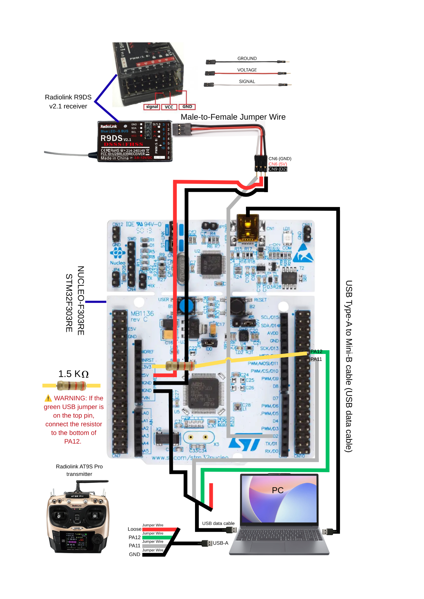

# Başlangıç — Sıfır Bilgiyle En Kısa Yol

Bu sayfa, elektronik veya STM32 bilmeden projeyi çalıştırmak isteyen kullanıcı içindir. Ayrıntılı ana rehber için kök dizindeki [README.md](../README.md) dosyasını okuyun.

## Yapacağınız 6 iş

1. `release/STM32_SBUS_USB_HID_Joystick.elf` dosyasını STM32CubeProgrammer ile NUCLEO-F303RE'ye yükleyin.
2. R9DS'yi SBUS moduna alın ve `9/S.B → PA10`, `VCC → 5V`, `GND → GND` bağlayın.
3. Mümkünse Tera Term ile SBUS'u doğrulayın: yaklaşık `74–75 fps`, `err=0`.
4. Native USB için `D+→PA12`, `D-→PA11`, `GND→GND`; kırmızı `5V` teli boşta kalsın.
5. `3V3 → ~1.5 kΩ → PA12/D+` pull-up bağlantısını yapın.
6. Windows'ta `joy.cpl` ile test edip PicaSim'de joystick'i etkinleştirip 4 ana ekseni eşleyin.

## Durmanız gereken durumlar

Aşağıdaki durumlardan biri varsa USB'yi bilgisayara takmayın:

- 3V3 ile GND kısa devre.
- D+ ile D- kısa devre.
- USB kırmızı 5V teli bağlı.
- D+ ve D- hangi kablo olduğu bilinmiyor.
- Pull-up 5V'a bağlanmış.

Ana rehber: [README.md](../README.md)
