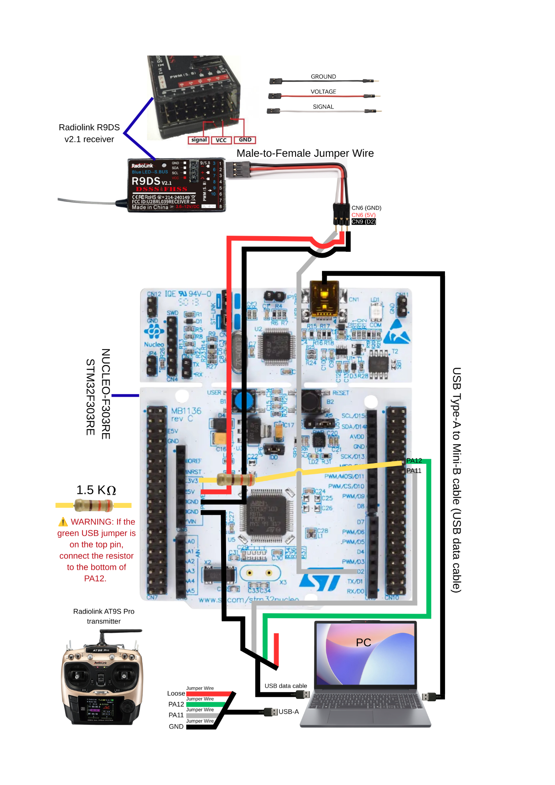
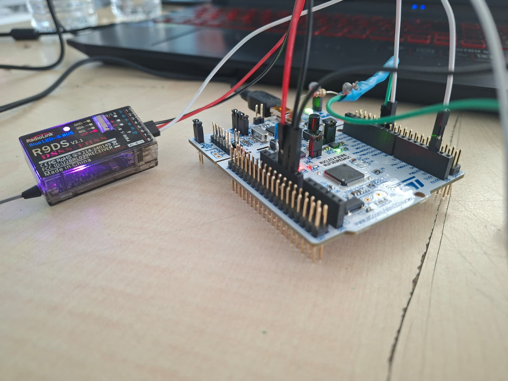
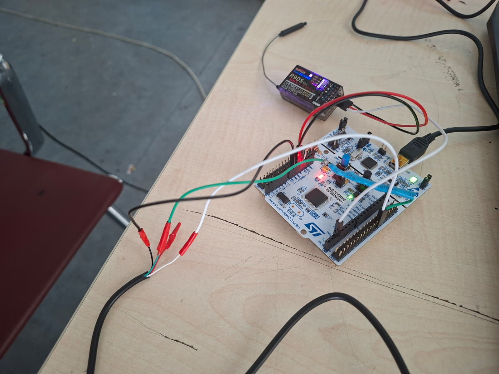

# Donanım Bağlantıları



## 1. R9DS → NUCLEO

| R9DS | NUCLEO |
|---|---|
| 9/S.B Signal | PA10 / D2 / USART1_RX |
| VCC | 5V |
| GND | GND |



## 2. Native USB → NUCLEO

| USB sinyali | NUCLEO |
|---|---|
| D+ | PA12 / USB_DP |
| D- | PA11 / USB_DM |
| GND | GND |
| +5V / kırmızı | İlk testte bağlanmaz |

## 3. D+ pull-up

```text
3V3 → 1.5 kΩ → PA12/D+
```

Alternatif:

```text
3V3 → 1 kΩ → 330 Ω → 220 Ω → PA12/D+
```



## 4. Güç kapalıyken multimetre testi

- 3V3 ↔ GND: continuity ötmemeli.
- 5V ↔ GND: continuity ötmemeli.
- PA12 ↔ PA11: continuity ötmemeli.
- 3V3 ↔ PA12: yaklaşık 1.5–1.55 kΩ.

## 5. Geliştirme sırasında iki USB

- ST-LINK USB: kartı besler ve programlar.
- Native USB data kablosu: PA11/PA12 üzerinden joystick verisini taşır.

Bu nedenle native USB kablosunun kırmızı 5V hattı ilk testte boş bırakılır.
