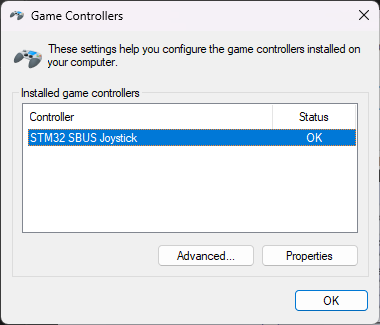
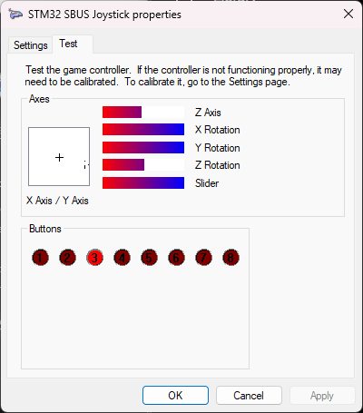
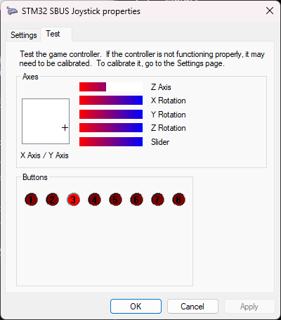

# Windows Testi

## Cihazı açın

```text
Win + R → joy.cpl
```

Beklenen:

```text
STM32 SBUS Joystick
Status: OK
```



## Eksenleri test edin

`Properties → Test` açın ve kumandayı hareket ettirin.



CH5 C switch üç konumda Button 1/2/3 üretir.



Windows burada doğru çalışıyorsa donanım ve firmware zinciri büyük ölçüde doğrulanmıştır.
