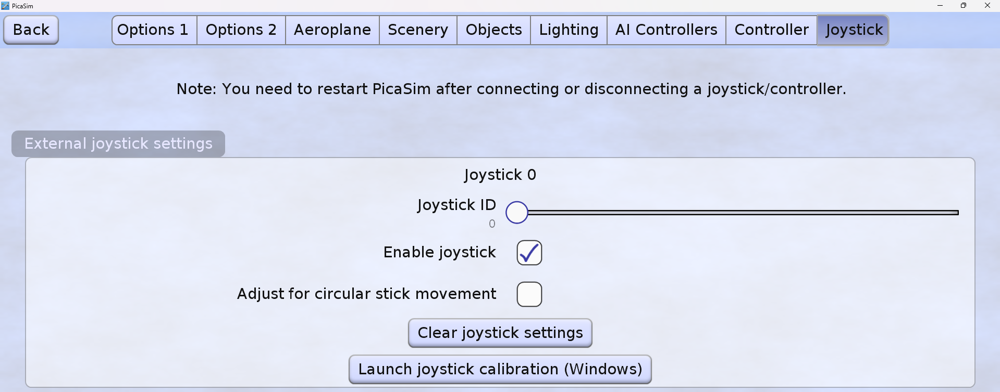
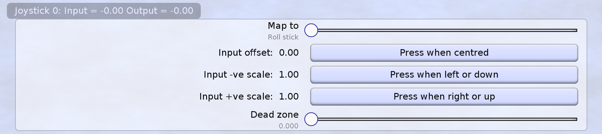
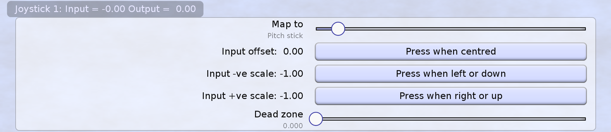
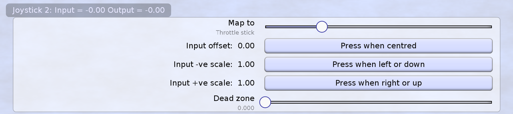
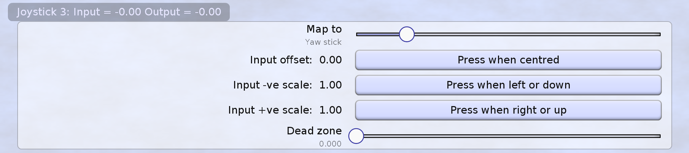

# PicaSim Ayarları

Windows testi geçmeden bu aşamaya geçmeyin.

1. Joystick bağlıyken PicaSim'i tamamen kapatıp tekrar açın.
2. `Joystick ID = 0`.
3. `Enable joystick` seçeneğini açın.

## Eşleme

| PicaSim | İşlev |
|---|---|
| Joystick 0 | Roll stick |
| Joystick 1 | Pitch stick |
| Joystick 2 | Throttle stick |
| Joystick 3 | Yaw stick |

## Kalibrasyon

Roll/Pitch/Yaw için merkez, negatif uç ve pozitif uç düğmelerini sırayla kullanın. Throttle için minimum ve maksimumu ayarlayın. Ters eksen için `Invert` kullanın.

PicaSim'in joystick takıldıktan/çıkarıldıktan sonra yeniden başlatılması gerekir.
