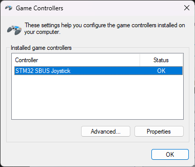
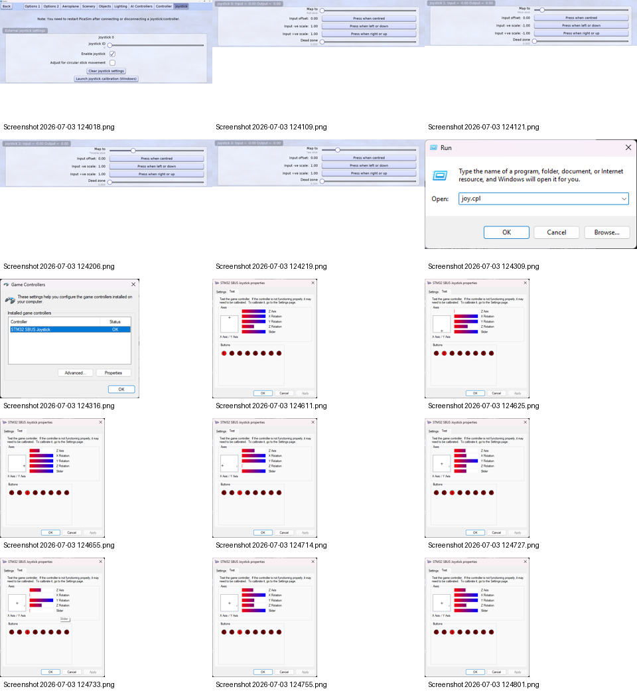

# Doğrulama Sonuçları

Bu bölüm teorik hedefleri değil, çalışan prototipte gözlenen sonuçları listeler.

| Test | Sonuç | Durum |
|---|---|---|
| Firmware build | 0 errors, 0 warnings | Başarılı |
| SBUS frame rate | 74–75 fps | Kararlı |
| Parser err | 0 | Başarılı |
| Normal flags | 0x00 | Başarılı |
| End byte | 0x00 | Başarılı |
| Failsafe | 0x04 → 0x0C, CH3≈200 | Başarılı |
| Windows detection | STM32 SBUS Joystick — OK | Başarılı |
| Windows axes/buttons | Properties → Test hareketi doğrulandı | Başarılı |
| PicaSim | Enable + 4 ana eksen mapping | Başarılı |

Örnek log:

```text
fps=74 err=0 | CH1=1000 CH2=1014 CH3= 950 CH4= 995 CH5=1800 CH6=1800 CH7= 252 CH8=1800 | flags=0x00 end=0x00
```




